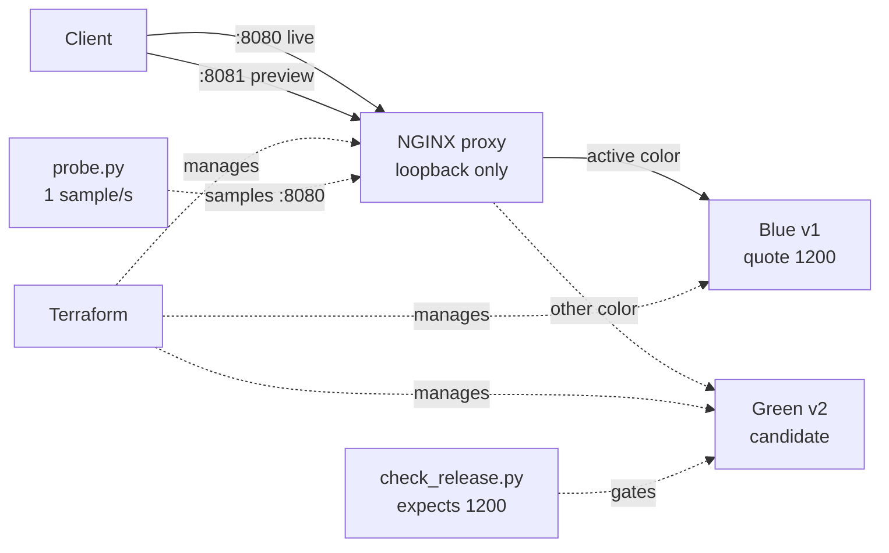
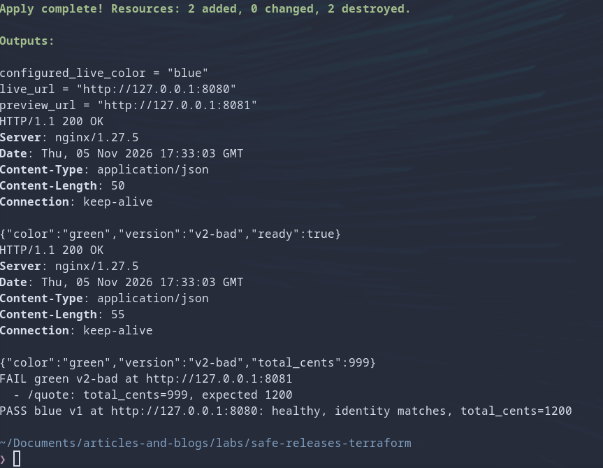
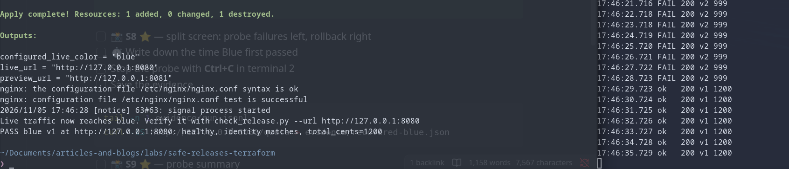

# Blue-green release gate in Terraform

[](https://github.com/MoYusuf1/blue-green-release-gate-terraform/actions/workflows/ci.yml)

A release can return HTTP 200 and still give the customer the wrong answer. This lab runs two releases behind a proxy, rejects a candidate that's healthy but wrong, and practices rolling back when a bad release reaches live traffic.

My [previous Terraform project](https://github.com/MoYusuf1/aws-privatelink-multi-vpc-terraform) was about infrastructure a team can review and rebuild. This one is about the release decision on top of it: is the new version correct for users, and how fast can I get back if it isn't? Everything runs locally with Terraform, Docker and NGINX, at no cost.
<!-- Add the LinkedIn write-up link here once it's published. -->

## Architecture



Terraform builds one image, one network, three generated configs and three containers. Only the proxy publishes ports, and only on 127.0.0.1. Each release returns a fixed quote that should be **1200 cents**; the lab injects 999 to simulate a defect.

## Results

From one manual run on 2026-11-05 (raw data in [`evidence/`](evidence), notes in [`notes.md`](notes.md)):

- A candidate answering `/health` and `/quote` with **HTTP 200** but quoting **999** failed the release check and never got live traffic.
- In the live fault drill the probe took **118 samples: 62 wrong quotes and 0 HTTP errors**. A monitor that only counted HTTP failures would have reported a clean minute.
- Wrong answers were live for about **61 seconds**, mostly the time it took me to notice and roll back. Traffic was back on Blue about a second after the reload.
- The same drill automated in CI (`make e2e`) left **3** wrong answers live instead of 62.





## Design decisions

| Decision | Why |
| --- | --- |
| [Fixed expected quote](docs/decisions/0001-fixed-expected-quote.md) | The check never reads the app's config, so a bad config can't change the test along with the answer. |
| [Routing change, not a redeploy](docs/decisions/0002-routing-change-is-not-a-redeploy.md) | Promote and roll back by switching the proxy. The previous release stays running, so rollback rebuilds nothing. |
| [Reload waits for traffic](docs/decisions/0003-reload-waits-for-traffic.md) | A reload counts as done when live traffic reaches the new release, not when NGINX accepts the signal. |
| Probe counts wrong answers as failures | The defect this lab is about never produces an HTTP error. |

## What broke along the way

On the first run, the check right after the proxy reload still reached the old release and failed, on both promotion and rollback ([before](screenshots/12.png)). NGINX reloads gracefully: new workers start while old ones finish, so `nginx -s reload` returns before traffic moves. My reload script reported success at that point. It now polls the live address until it returns the configured color, and fails after 15 seconds if it never does ([after](screenshots/6.png)).

## Quick start

Requires Terraform 1.12+, Docker and Python 3 (`setup.sh` installs them on Arch).

```bash
make apply      # Blue live on :8080, Green preview on :8081
python3 scripts/check_release.py blue v1 --url http://127.0.0.1:8080
python3 scripts/check_release.py green v2

python3 scripts/set_release.py green --version v2-bad --quote-total 999
terraform -chdir=terraform apply
python3 scripts/check_release.py green v2-bad    # FAIL: healthy but wrong

make destroy
```

`make e2e` runs the whole drill hands-free in about a minute and cleans up after itself.

## Testing and CI

| Command | What it proves | Needs Docker |
| --- | --- | --- |
| `make lint` | `terraform fmt` and `validate` | No |
| `make test` | Terraform tests with a mocked Docker provider: live and preview follow the active color, promotion swaps them, each release serves its own quote and readiness, only the proxy publishes ports and only on loopback, bad inputs are rejected. Plus tests for the check, probe and reload scripts. | No |
| `tflint` | Terraform's recommended lint rules | No |
| `make e2e` | The real drill against real containers: the gate rejects a wrong candidate, promotion moves traffic, a live fault is caught and rolled back, and the probe confirms traffic ends correct. | Yes |

CI runs all four on every push. The e2e job runs on GitHub's runner, which has Docker, and uploads the probe log as an artifact.

## Cost and limitations

Free: everything runs on your machine.

- One machine, fixed responses, local state.
- Promotion and rollback are manual decisions, scripted only in `make e2e`.
- No database, so it doesn't cover data changes that make a rollback unsafe.
- The probe samples once a second, so a shorter gap could slip past it.
- Checkov isn't in CI: it has no rules for the Docker provider, so it would pass without checking anything. It belongs in the AWS version.

## Next steps

- Rebuild the same flow on AWS with ECS and weighted ALB target groups, reusing the same release check.
- Roll back automatically when a CloudWatch synthetic check on `/quote` fails.
